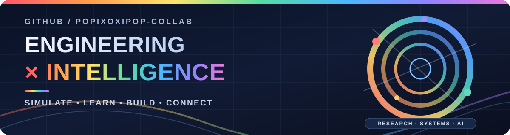
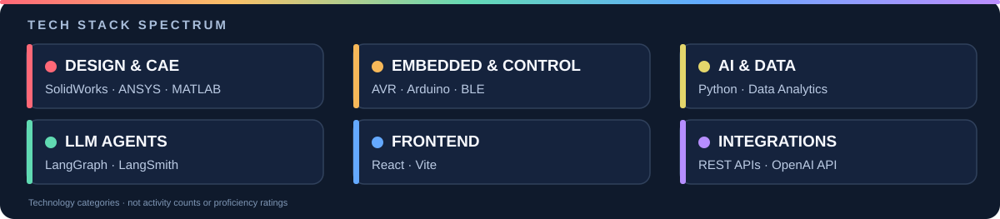
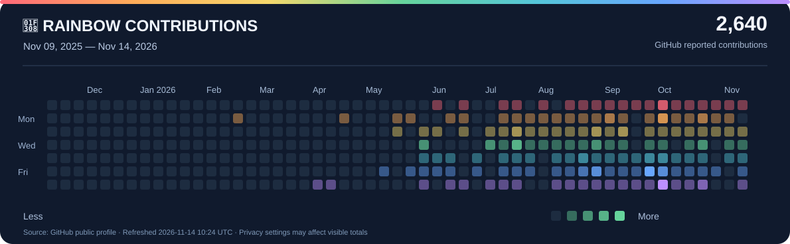

  

<h1 align="center">안녕하세요, 노경천입니다 👋</h1>

<strong>Mechanical Engineering × AI × Systems</strong>

> 기계공학 기반의 **시스템적 사고**로 하드웨어(설계·해석·임베디드)와 소프트웨어(AI·데이터·웹)를 잇는 문제 해결을 지향합니다.

### 🌈 기술 스펙트럼

  

### 📅 최근 1년 GitHub 활동 — 레인보우 캘린더

  

GitHub가 공개 프로필에 표시하는 **실제 날짜별 기여 수**를 바탕으로 만들었으며, **매일 12:17 KST에 자동 갱신**하도록 설정했습니다. 색상은 요일별 무지개색이며 진하기는 GitHub 활동 수준을 나타냅니다. 비공개 기여 공개 설정은 GitHub 계정 설정을 따릅니다.

[📊 GitHub 기본 기여 그래프에서 보기](https://github.com/popixoxipop-collab) · [🔍 활동표 확대해서 보기](./assets/rainbow-contributions.svg)

### 🛠 관심·보유 기술

- **설계/해석(CAE)**: SolidWorks · ANSYS Workbench · MATLAB/Simulink
- **임베디드/제어**: ATmega128(AVR-C) · Arduino · BLE · 센서 융합
- **AI/데이터**: Python · LLM Agent(LangGraph·LangSmith) · 데이터 분석
- **웹**: React · Vite · REST · OpenAI API

### 📫 연락처

- Email: popixoxipop@gmail.com
- GitHub: https://github.com/popixoxipop-collab

*기업의 문제를 함께 풀 수 있는 재사용 가능한 역량을 보여드리겠습니다.*
